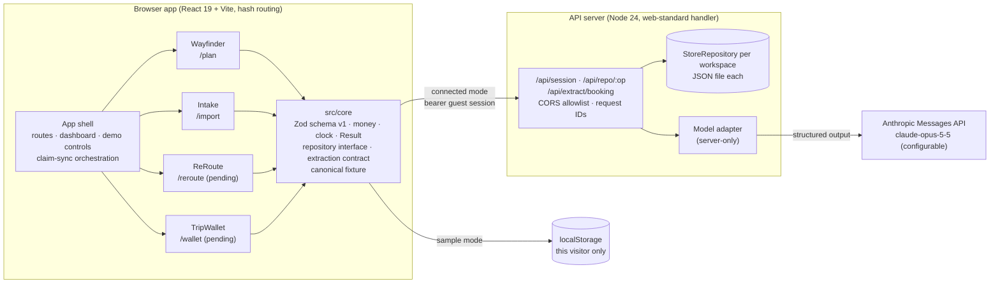

# WayFare architecture and technical decisions

Owner: Agent 1. Written against main `45dbc20` (November 1, 2026). Setup, configuration and release steps are in [RELEASE_GUIDE.md](RELEASE_GUIDE.md), the contract details are in [CONTRACTS.md](CONTRACTS.md), and live status is tracked in [#8](https://github.com/Jiwoo-Jung-Cal/wayfare/issues/8).

## What WayFare automates

WayFare automates the money side of a trip:
- **Wayfinder** compares itineraries with transparent totals.
- **Intake** turns pasted confirmation emails into reviewed, source-backed booking records.
- **ReRoute** works out what each recovery choice costs when a trip is disrupted, and which deadlines matter.
- **TripWallet** tracks the refunds that should follow, reconciles them against what actually arrives, and keeps vouchers and points separate from cash.

The guiding rule is: **AI extracts and explains; deterministic code calculates money, applies reviewed rules and commits state.**

## System overview

- **One application.** Each feature registers itself by exporting `feature` from `src/features/<key>/index.ts`, and the shell picks it up automatically. Features talk to each other only through the shared repository and the hooks on `FeatureContext`; they never import each other's files.
- **One contract source.** Every entity is a Zod schema in `src/core/schema.ts`. TypeScript types are derived from it, the server validates with it, and the browser validates with it. Nothing is maintained twice by hand.
- **One store engine.** `StoreRepository` enforces workspace scoping, optimistic revisions, idempotent replays, uniqueness and per-operation atomicity. Sample mode wraps it with browser storage. The server wraps one instance per guest workspace with file storage. The same rules therefore apply in both modes.

## Module map

| Path | Owner | Responsibility | Status on main |
| --- | --- | --- | --- |
| `src/core/` | Agent 1 | Schema v1, money, instants and clock, Result/AppError, repository interface and store, extraction contract and normalization, canonical fixture, HTTP clients | Done |
| `src/app/`, `src/ui/`, `src/styles/` | Agent 1 | Shell, routes, dashboard, demo controls, claim-sync orchestrator, shared components, placeholder tokens | Done (visual design pending) |
| `server/` | Agent 1 | API handler, guest sessions, persistence, model adapter, extraction endpoint | Done locally; not hosted |
| `src/features/wayfinder/` | Agent 2 | Preference-driven plan comparison and selection | Merged (#17) |
| `src/features/intake/` | Agent 2 | Paste → extract → review → save | Merged (#17) |
| `src/features/reroute/` | Agent 4 (Kelvin) | Recovery options, eligibility, CancelClock, action records | Not delivered (#6) |
| `src/features/tripwallet/` | Agent 5 (Brian) | Claim sync, receipt matching, balances, credits and points | Not delivered (#7) |
| `e2e/`, `src/app/integration.test.ts` | Agent 1 | Browser journey and cross-module integration tests | Done for delivered modules |
| `.github/`, `coordination/` | Agent 3 | CI, progress dashboard | Done |

## The demo journey and who computes what

Each step lists who owns it and whether it works today.

1. **Load the sample trip** (shell). Fictional SFO → NYC trip, Nov 20–23, 2026. The demo clock starts at `2026-11-18T17:00:00Z`. *Working.*
2. **Compare and select a plan** (Wayfinder). Totals are computed in integer cents, and an unknown price is never treated as free. A selected plan is not a booking. *Working.*
3. **Import confirmations** (Intake, plus Agent 1's extraction backend).
   - Text goes to the extraction service. In connected mode that's the server-side AI; otherwise it's a deterministic sample extractor.
   - The result is normalized deterministically and reviewed by the user, then saved through `saveReviewedBooking`.
   - Saving is idempotent: the same document never creates a second booking.
   - The four bookings total $900. *Working; live AI unverified.*
4. **Disruption** (ReRoute; the shell records the fact as a fallback). Simulated outbound cancellation. *Fact recording works; recovery is pending #6.*
5. **Recovery options and the deadline** (ReRoute).
   - Continue: the replacement flight costs $360, and $940 is forecast after the $320 refund.
   - Cancel the trip: $820 is expected back.
   - The hotel recovery drops from $400 to $200 **at exactly** `2026-11-19T23:00:00Z`. *Pending #6.*
6. **Approve** (ReRoute). One atomic, idempotent `ActionRecord` per booking. Approval is simulated and never claims a real cancellation. *Pending #6.*
7. **Claims** (shell orchestration plus TripWallet).
   - After each recorded action, and on every wallet load, the shell calls TripWallet's idempotent `syncClaimsFromActions`.
   - If that fails, the action is kept and a "Retry claim sync" state is shown. *Orchestration is done and tested; the TripWallet logic is pending #7.*
8. **Reconcile** (TripWallet). The provider confirms $400 due by Nov 25. A $250 receipt leaves $150 outstanding, and a further $150 completes it. The $75 voucher and 8,000 points stay separate from cash. *Pending #7.*

The dashboard shows each owner's stored results and recalculates nothing itself, so a figure has exactly one source.

## Key technical decisions

| Decision | Why | Alternative considered |
| --- | --- | --- |
| **AI extracts, code decides.** The model returns strings only (local wall time plus IANA timezone, decimal amounts). Code converts them to UTC instants and integer minor units. Any value whose supporting excerpt is not found verbatim in the source becomes `unknown`. | Prevents invented refund rules or amounts, makes every figure auditable back to source text, and blunts prompt injection hidden in pasted documents. | Letting the model output final structured money and dates. Simpler, but it can't be verified, and arithmetic errors become silent. |
| **Integer minor units with explicit currency, and unknown is not zero.** | Financial figures must be exact. A missing price must never read as $0 or "free". | Floats or decimal strings. Rounding errors, and unknowns get confused with zero. |
| **One clock and frozen deadline semantics.** Deadlines are met only when `t < D`, and windows are half-open. | Every route compares deadlines identically, and demo controls can move time deterministically to the boundary. | Each feature reading `Date.now()`. Inconsistent results across screens and untestable boundaries. |
| **One canonical fixture** (`DEMO_IDS`, `DEMO_EXPECTED`, `demoCancelTripActions`). | Five parallel agents test against the same numbers and IDs, which freezes cross-module handoffs. | A fixture per feature. Copies drift, and handoffs break at integration. |
| **Idempotency everywhere it can be replayed.** Reviewed save is keyed by document hash, actions by key, claims by action and component, receipts by reference. | Double clicks, retries and reloads never double financial records. | Client-side "disable the button". Not enough across reloads and network retries. |
| **Claim handoff by orchestrated idempotent sync** (after an action, on wallet load, on retry), with no message queue. | Automatic handoff that recovers from interruption without running infrastructure. | A background queue or webhooks. More moving parts than a demo needs. |
| **Two explicit modes.** Sample mode (browser storage, simulated extraction) and connected mode (server). A connected failure is shown as an error; falling back to sample mode is a deliberate user choice. | Honest capability labels: a failed live request never looks like success. | Silent fallback to fixtures. Misleading in a demo about financial accuracy. |
| **Web-standard API handler** (`(Request) => Response`) run directly by Node 24, which strips TypeScript types at runtime. | No build step for the server. The handler can be wrapped for Deno or edge runtimes (for example Supabase Edge Functions) without changes. | Express or a framework server, or adopting Supabase immediately. That needs a provisioned project and credentials, which are the owner's decision. |
| **Official Anthropic SDK** with Zod structured outputs, `claude-opus-5-5` by default (`WAYFARE_AI_MODEL` overrides), explicit effort, and server-side fallback for refusals. | The SDK's Zod helper validates against the same schema library as the contracts, and typed errors map cleanly to the shared error shape. | Raw HTTP, or another provider. More hand-written validation and error mapping. |
| **Testing pyramid.** | See below. | Markup snapshot tests. They check little about financial behavior. |

The testing pyramid, from the bottom up:
- **Unit tests** for money, deadline boundaries, store constraints, extraction normalization and API security.
- **Integration tests** for orchestration, plus gated checks that switch on automatically when ReRoute or TripWallet register.
- **Browser E2E** through the real UI: sample mode, connected mode with two isolated visitors (#23), and mobile widths.
- **Mutation checks:** I deliberately broke a deadline rule and confirmed the E2E failed.
- **CI** runs all of it on every PR and every push to main.

### Multi-agent development workflow

Five AI coding agents worked in parallel on one GitHub repository, each with a single owner per path:

- **Coordination:** one Issue per task, structured progress comments that feed an automatic dashboard (#1), and short-lived branches and PRs with task markers.
- **Shared code:** Agent 1 publishes the contracts and fixtures first, then integrates, so feature agents build against stable imports rather than guessing interfaces.
- **Design:** Jiwoo alone owns visual design. Code uses neutral placeholder tokens (`--wf-*` CSS variables) until a design revision is approved.

## Security and privacy

- **Secrets stay server-side.** The browser receives only the non-secret API URL. The AI key is read only by the server, and the server ignores an inherited `ANTHROPIC_BASE_URL`. The production bundle is checked to contain no Anthropic API strings.
- **Guest sessions.**
  - Tokens are 32 random bytes, and only their SHA-256 is stored.
  - Every repository call is scoped to the token's workspace, and a record carrying another workspace's ID is rejected with `forbidden`.
  - This is covered by API tests and by the two-visitor browser test.
- **CORS** allows only the exact origins listed. Any other browser origin gets 403.
- **Untrusted documents.** Pasted text is wrapped as `<document>` data with instructions to ignore embedded commands. Size is limited to 20,000 characters, and logs never contain document text.
- **Hardening (#22):** sessions expire (7 days by default), and there are rate limits on creating sessions (per IP) and on extractions (per workspace), returning 429 with `Retry-After`.

## Deployment options (decision pending)

| Surface | What it needs | Verified |
| --- | --- | --- |
| **Static sample demo** (GitHub Pages, any static host, a Figma-embedded build) | `npm run build`, then serve `dist/`. The relative base and hash routing need no server rewrites. | Yes. The production build was served from a sub-path (`/wayfare/demo/`) on a bare static server: the deep link to `/plan` loaded, imported bookings survived a reload, and there were no page errors or failed requests. |
| **Connected API** | Node 24 with a persistent disk, or the handler wrapped for an edge runtime. Set `WAYFARE_ALLOWED_ORIGINS` to the exact app origin, `ANTHROPIC_API_KEY` for live AI, and build the app with `VITE_WAYFARE_API_URL`. Behind a proxy, set `WAYFARE_TRUST_PROXY=1`. | Local only, in unit, API, browser (two-visitor) and CI tests. Not hosted. |
| **Figma Code Layer** | Figma access and seat confirmation by Jiwoo. | Unverified. There was no Figma connector in the integration sessions. |

## Known limitations (current)

- ReRoute and TripWallet are not delivered, so the recovery and reconciliation half of the journey is pending.
- Live AI extraction has never been run, because no API key is configured. The sample extractor is labeled "Simulated".
- The connected API is not hosted. File persistence and in-memory rate limits assume a single server instance.
- Visual design is pending Jiwoo's approval; the screens are functional previews.
- Single traveler, single currency (USD), fictional providers. Real bookings, cancellations, payments, OCR and email are out of scope.
